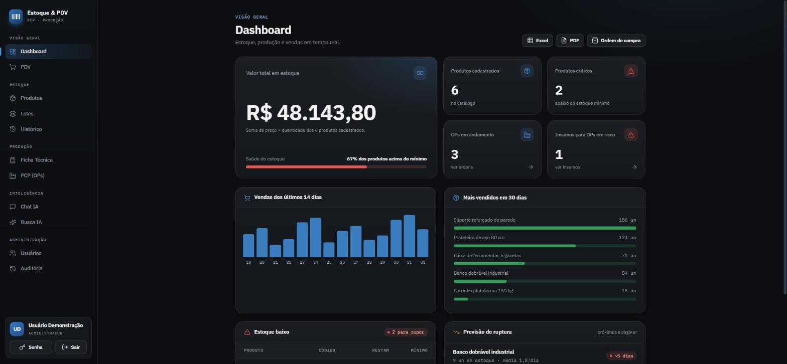
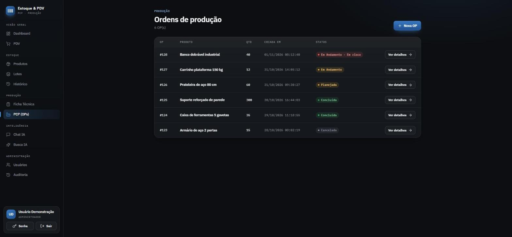
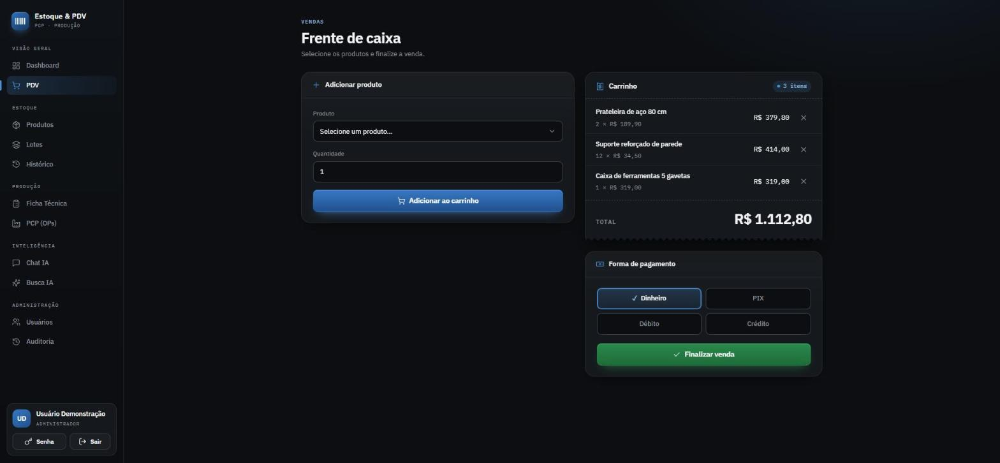
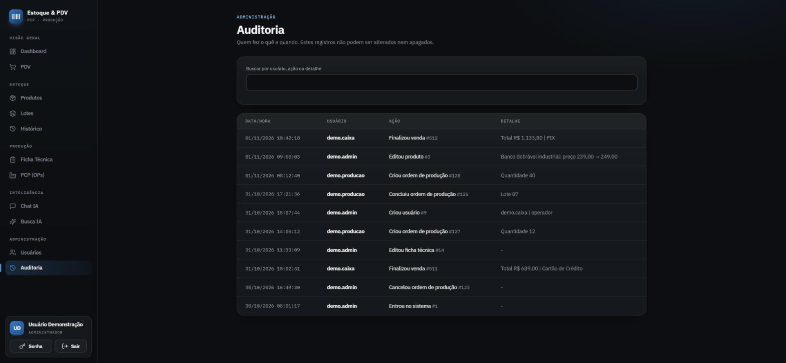
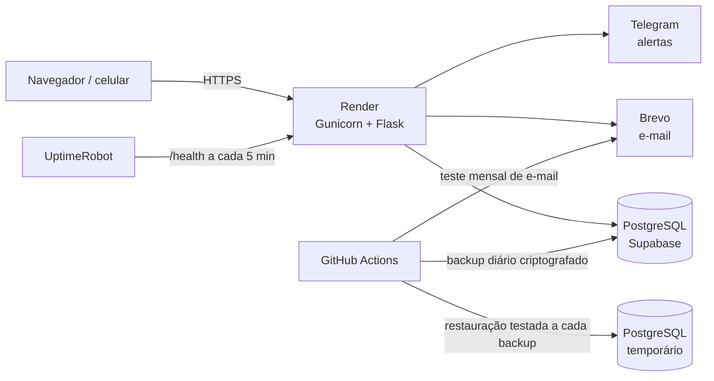

# 📦 Planejamento em Foco

**Sistema web de estoque, PCP (Planejamento e Controle da Produção) e vendas para fábricas pequenas.**

Nasceu da minha experiência em Logística e PCP: estoque, produção e vendas espalhados em planilhas que não conversam, falta de insumo no meio da produção e estoque que nunca bate.

> 🔒 O código-fonte é privado porque o sistema roda em produção. Este repositório mostra o produto, a arquitetura e as decisões técnicas. Demonstração ao vivo sob pedido pelo [LinkedIn](https://www.linkedin.com/in/mateus-fernandes-623b0926b/).



| Ordens de produção | Frente de caixa |
|---|---|
|  |  |



*Imagens feitas com dados fictícios de demonstração, de uma metalúrgica inventada.*

## O que ele faz

| Módulo | Destaques |
|---|---|
| 🏭 **PCP** | Ficha técnica (BOM), ordens de produção com cálculo automático de insumos, alerta de insumos em risco |
| 🏷️ **Rastreabilidade** | Cada produção gera um lote ligado à ordem de produção |
| 📦 **Estoque** | Cadastro com leitura de código de barras pela câmera do celular, alertas de estoque crítico |
| 📈 **Previsão** | Velocidade de venda indica em quantos dias cada produto acaba |
| 🛒 **PDV** | Frente de caixa com baixa automática no estoque |
| 🔎 **Busca e chat** | Busca tolerante a erros de digitação e assistente de consulta |
| 📄 **Relatórios** | Excel, PDF e ordem de compra |
| 📊 **Dashboard** | Vendas dos últimos 14 dias e produtos mais vendidos |
| 👥 **Acesso** | Perfis de administrador e operador, recuperação de senha por e-mail |
| 🧾 **Auditoria** | Registro de quem fez o quê e quando, sem permitir alterar ou apagar |

## Arquitetura



**Stack:** Python, Flask, PostgreSQL, Jinja, scikit-learn, Pandas, ReportLab, Gunicorn, GitHub Actions.

## Decisões técnicas que valem a conversa

### 1. O servidor caía por falta de memória
**Problema:** os logs mostravam `Ran out of memory (used over 512MB)`. A busca semântica carregava PyTorch e um modelo de quase 500 MB num servidor de 512 MB.

**Solução:** troquei por TF-IDF com n-gramas de caracteres (scikit-learn). Continua achando "parafuzo" quando o cadastro diz "Parafuso", responde em milissegundos e tirou o PyTorch do deploy.

```python
vetorizador = TfidfVectorizer(analyzer="char_wb", ngram_range=(2, 4), sublinear_tf=True)
matriz = vetorizador.fit_transform(textos_dos_produtos)
similaridades = linear_kernel(vetorizador.transform([consulta]), matriz)[0]
```

**Lição:** a melhor tecnologia é a que cabe na restrição real do projeto.

### 2. O site não pode morrer junto com o banco
**Problema:** se o banco estivesse fora quando o servidor ligava, ele entrava num ciclo de reinícios. Testando com o banco desligado, achei um segundo ponto de falha escondido num `import`.

**Solução:** retry com backoff, inicialização que tenta de novo a cada 30 segundos, página amigável de indisponibilidade e rota `/health` para monitoramento.

```python
for tentativa in range(3):
    try:
        return psycopg2.connect(DATABASE_URL, sslmode="require", connect_timeout=10)
    except psycopg2.OperationalError:
        if tentativa == 2:
            raise
        time.sleep(0.5 * (tentativa + 1))
```

### 3. Recuperação de senha sem criar uma porta de entrada
- Código aleatório (`secrets`) e, no banco, só o hash SHA-256 dele
- Link de 30 minutos e uso único, marcado numa única operação para evitar condição de corrida
- Mesma resposta exista ou não o e-mail, com envio em segundo plano, para não revelar quem está cadastrado
- Endereço do link vem de configuração, nunca do cabeçalho `Host` (*host header poisoning*)
- Limite de pedidos por IP e por e-mail

### 4. Permissão se verifica no servidor
Esconder um botão não protege nada: quem sabe mexer manda o pedido direto. Cada rota sensível checa o perfil no servidor, e os testes simulam um operador enviando requisições diretas às rotas de administrador.

### 5. Backup só vale depois de restaurado
**Problema:** um arquivo de backup pode existir e mesmo assim não funcionar. No primeiro teste de restauração, ele falhou porque o schema já existia no banco novo.

**Solução:** a cada backup, o robô restaura a cópia em um PostgreSQL temporário e compara as tabelas principais com o banco real. Se a prova falhar, a execução fica vermelha.

**Lição:** falhar no teste é melhor do que falhar no desastre.

### 6. Auditoria que nem o sistema consegue apagar
**Problema:** um histórico comum pode ser alterado por quem tem acesso a ele.

**Solução:** as ações importantes vão para uma tabela protegida por um gatilho (*trigger*) que bloqueia `UPDATE` e `DELETE` no próprio banco. Se o registro falhar, a operação principal continua, para que o histórico nunca derrube o sistema.

## Segurança

- Proteção contra CSRF, XSS e clickjacking, com CSP e HSTS
- Senhas com PBKDF2 (600 mil iterações) e salt; regra de senha forte
- Bloqueio após tentativas de login erradas
- Consultas parametrizadas contra SQL injection
- Row Level Security no banco e segredos só em variáveis de ambiente
- Backup diário criptografado com AES-256, com restauração testada automaticamente
- Auditoria protegida no banco e chaves externas com o mínimo de permissão

## Como trabalho

Planejamento em 6 passos (produto, técnica, fluxos, design, dados e entregas), com permissões, segurança e testes definidos por entrega. Uso IA como par de programação, e cada mudança passa por teste e revisão antes de ir para produção.

## Autor

**Mateus Fernandes** — estudante de Análise e Desenvolvimento de Sistemas (Estácio), técnico em Logística (Firjan SENAI), com experiência como Jovem Aprendiz em PCP.

💼 [LinkedIn](https://www.linkedin.com/in/mateus-fernandes-623b0926b/)
